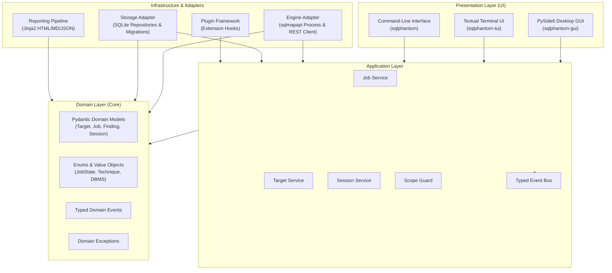
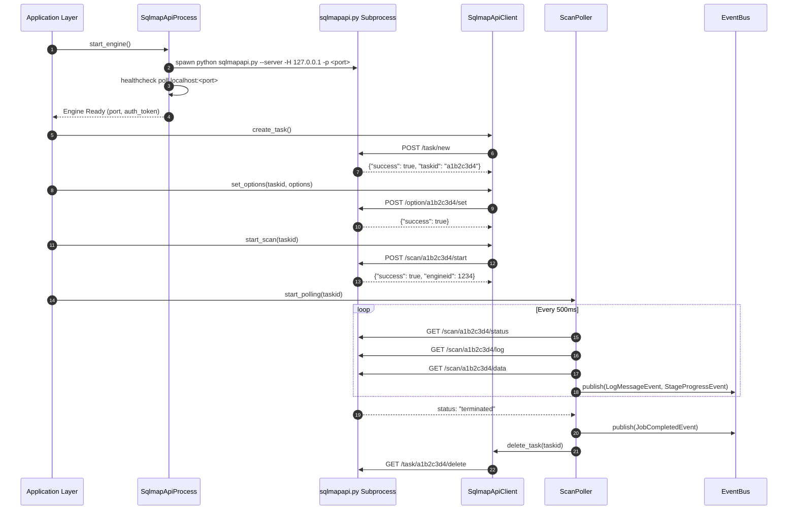
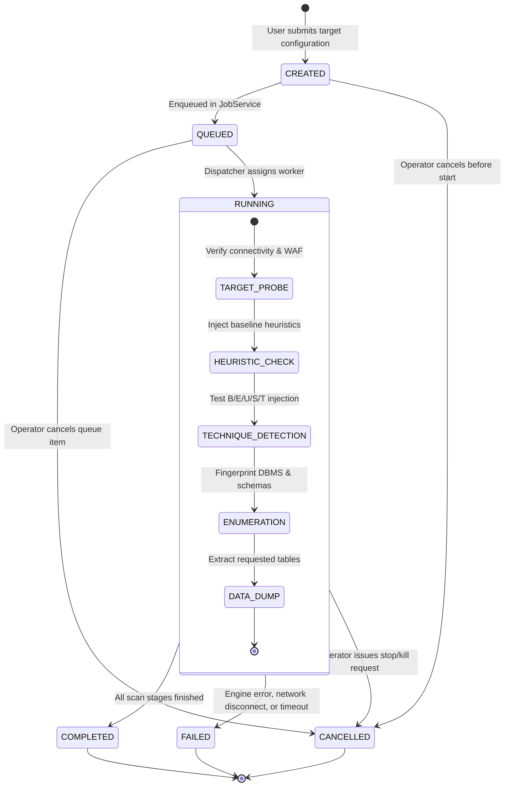

# SQLPhantom Technical Architecture

This document describes the technical architecture, design patterns, component relationships, and execution models of **SQLPhantom**.

---

## 1. Architectural Philosophy: The Modular Monolith

SQLPhantom is structured as a **clean, modular monolith**. It combines the rapid developer velocity and deployment simplicity of a monolithic codebase with the strict boundary isolation, testability, and decoupling of a hexagonal/onion architecture.

### Key Architectural Tenets:
1. **Engine Decoupling via REST API**: Upstream sqlmap is treated as an external black-box engine running as an isolated subprocess (`sqlmapapi.py --server`). SQLPhantom never imports upstream sqlmap internals (`lib.core.*`, `conf`, `kb`) into the main application process. This protects UI responsiveness and prevents global state pollution.
2. **Strict Inward Dependency Flow**: The core domain model has zero external library dependencies. The application layer depends only on domain abstractions. Outer layers (engine adapters, storage repositories, UI presentation) depend inward upon domain and application interfaces.
3. **Reactive, Event-Driven Communication**: Components communicate asynchronously through a typed `EventBus`. Presentation frontends (PySide6 GUI and Textual TUI) react to domain events rather than polling the engine directly.
4. **Resilient Persistence**: All assessment state, raw logs, target configurations, and discovered findings are persisted in an embedded SQLite database using ACID transactions and Write-Ahead Logging (WAL).

---

## 2. Component Architecture & Dependency Direction

The following diagram illustrates the component layers and allowed dependency directions:



### Dependency Rules:
- **Domain Layer (`src/sqlphantom/domain`)**: The foundation. Contains entities, value objects, domain events, and business invariants. It depends **only** on Python standard library and `pydantic`. It must **never** import from `application`, `engine`, `storage`, `gui`, or `tui`.
- **Application Layer (`src/sqlphantom/application`)**: Orchestrates business use cases, manages transactions, enforces target scope rules, and coordinates the event bus. It defines abstract repository and engine interfaces (ports).
- **Engine Layer (`src/sqlphantom/engine`)**: Implements engine port abstractions. Manages the lifecycle of the `sqlmapapi.py` subprocess, translates domain scan configurations to REST payloads, and polls telemetry.
- **Storage Layer (`src/sqlphantom/storage`)**: Implements persistence port abstractions. Interacts with SQLite, manages transactions, and executes database migrations.
- **Reporting Layer (`src/sqlphantom/reporting`)**: Consumes domain models to generate structured HTML, Markdown, and JSON assessment reports.
- **Presentation Layer (`gui`, `tui`, `cli`)**: Thin clients that consume application services and render reactive state changes.

---

## 3. Directory Layout

The repository layout reflects these architectural boundaries:

```
d:/Projects/SQLPhantom/
├── pyproject.toml              # Build system, dependencies, tool configurations
├── migrations/                 # SQLite database schema migration scripts
├── sqlmap/                     # Pristine upstream sqlmap submodule (pinned commit 6e06114)
├── src/
│   └── sqlphantom/
│       ├── __init__.py         # Package metadata, version, branding constants
│       ├── cli.py              # CLI entry point dispatcher (sqlphantom, -gui, -tui)
│       ├── domain/             # Enterprise domain entities & value objects
│       │   ├── models/         # Pydantic v2 models (Job, Target, Finding, Session)
│       │   ├── enums.py        # Domain enums (JobState, InjectionTechnique, Severity)
│       │   ├── events.py       # Typed domain event definitions
│       │   └── exceptions.py   # Domain-specific exception hierarchy
│       ├── application/        # Use cases and service orchestration
│       │   ├── services/       # JobService, TargetService, SessionService
│       │   ├── scope.py        # Scope validation and URL whitelist guardrails
│       │   └── events.py       # Async EventBus implementation
│       ├── engine/             # sqlmap REST API adapter and supervisor
│       │   ├── process.py      # Subprocess lifecycle supervisor (spawning sqlmapapi)
│       │   ├── client.py       # Async HTTP client (HTTPX) for sqlmap REST API
│       │   ├── mapper.py       # Domain config <-> sqlmap option translator
│       │   └── poller.py       # Telemetry polling worker and event generator
│       ├── storage/            # Persistence layer
│       │   ├── database.py     # SQLite connection pool and WAL setup
│       │   ├── migrations.py   # Migration runner and version tracker
│       │   └── repositories/   # JobRepository, FindingRepository, TargetRepository
│       ├── reporting/          # Multi-format report generators
│       │   ├── html.py         # Jinja2 HTML report generator
│       │   ├── markdown.py     # GFM report generator
│       │   └── json_export.py  # Machine-readable JSON exporter
│       ├── plugins/            # Plugin hooks and sandboxed execution
│       ├── gui/                # PySide6 desktop graphical interface
│       │   ├── windows/        # Main application window, dialogs
│       │   ├── views/          # Target view, console view, schema tree, data grid
│       │   └── viewmodels/     # Decoupled UI state controllers
│       └── tui/                # Textual terminal user interface
│           ├── app.py          # Textual Application subclass
│           ├── screens/        # Main dashboard, target entry, findings browser
│           └── widgets/        # Log stream viewer, telemetry tables
└── tests/                      # Automated test suite
    ├── unit/                   # Fast isolated unit tests (domain, models, mappers)
    ├── integration/            # Subprocess, REST API, and SQLite integration tests
    ├── gui/                    # PySide6 UI tests (pytest-qt)
    ├── tui/                    # Textual UI async tests
    └── lab/                    # Controlled local test targets (vulnerable testbeds)
```

---

## 4. Engine Integration: Adapter Pattern via `sqlmapapi`

A central architectural decision in SQLPhantom is integrating with upstream sqlmap exclusively through its official REST API (`sqlmapapi.py --server`).



### Why the REST API Adapter Pattern?
1. **Memory & State Protection**: Upstream sqlmap relies heavily on module-level globals (`conf`, `kb`). Attempting to import sqlmap directly inside a multi-threaded desktop GUI causes global state collisions between concurrent scans and memory leaks.
2. **Process Boundary Isolation**: If the detection engine encounters an unhandled exception, high-memory condition, or fatal error, only the isolated subprocess terminates. The SQLPhantom GUI/TUI interface remains completely responsive.
3. **License & Upstream Upgrade Cleanliness**: Upstream sqlmap remains a pristine, unmodified git submodule. Upgrading to future sqlmap releases requires only updating the submodule commit pointer without merge conflicts.

---

## 5. Job Lifecycle State Machine

Assessments run as discrete jobs governed by a strict, finite state machine:



### Lifecycle Invariants:
- A job in `CREATED` or `QUEUED` state has not consumed engine task slots.
- When transitioning to `RUNNING`, the `ScopeGuard` must validate the target host; otherwise, the transition is rejected with a domain error.
- When a job terminates (`COMPLETED`, `FAILED`, `CANCELLED`), the engine task is purged, and aggregate metrics (elapsed time, total HTTP requests, findings count) are finalized in SQLite.

---

## 6. Event-Driven Model (`EventBus`)

To keep presentation layers decoupled from domain logic, SQLPhantom uses an asynchronous **`EventBus`**:

### Domain Events Hierarchy:
- `JobCreatedEvent`: Emitted when a new scan job is scheduled.
- `JobStateChangedEvent`: Emitted whenever a job transitions between states.
- `LogMessageReceivedEvent`: Emitted when raw output is parsed from the engine.
- `TargetProbedEvent`: Emitted upon verifying connectivity, latency, and WAF headers.
- `VulnerabilityFoundEvent`: Emitted when a confirmed SQL injection payload is discovered.
- `SchemaDiscoveredEvent`: Emitted when databases, tables, or columns are enumerated.
- `TableDataExtractedEvent`: Emitted when row data is dumped.

### Thread Bridging:
Because PySide6 requires GUI updates to occur on the main Qt GUI thread, background event bus listeners bridge events to the UI using Qt's thread-safe signal/slot mechanism via a custom `QtEventDispatcher`. For the Textual TUI, events are posted to the active screen message queue via Textual's async reactive properties.

---

## 7. Worker Isolation & Subprocess Management

Subprocess management is handled by `SqlmapApiProcess`:

- **Process Spawning**: Uses Python's standard `subprocess.Popen` with argument vectors (avoiding `shell=True`). On Windows, process creation flags include `CREATE_NO_WINDOW` (`0x08000000`) to prevent console window flashing.
- **Port Management**: Dynamically probes localhost for an available TCP port (defaulting to 8775) to prevent collisions with pre-existing sqlmap daemons.
- **Health Monitoring**: Periodically sends heartbeat HTTP requests to `/task/new` to verify responsiveness.
- **Graceful Shutdown**: On application exit or scan cancellation:
  1. Sends HTTP `GET /scan/<taskid>/stop` to request graceful engine cessation.
  2. If the task does not stop within 2 seconds, sends `GET /scan/<taskid>/kill`.
  3. On daemon shutdown, issues `SIGTERM` (POSIX) or `TerminateProcess` (Windows), followed by process wait with a timeout.

---

## 8. Storage Layer & Persistence

All application state is maintained in an embedded SQLite database (`sqlphantom.db`).

### Schema & Repositories:
- **`SessionRepository`**: Manages top-level user workspaces and engagement metadata.
- **`TargetRepository`**: Stores target URLs, HTTP headers, authentication parameters, and scope boundaries.
- **`JobRepository`**: Stores job states, configurations, timestamps, error messages, and execution metrics.
- **`FindingRepository`**: Stores discovered vulnerabilities (CWE-89), injection techniques, parameters, and payloads.
- **`LogRepository`**: Stores indexed engine log lines associated with each job for retrospective audit review.

### Concurrency & Migrations:
- **Write-Ahead Logging (WAL)**: Initialized with `PRAGMA journal_mode = WAL; PRAGMA synchronous = NORMAL;` to allow simultaneous background write operations and foreground UI read queries without locking contention.
- **Migration Runner**: An integrated schema versioning engine checks the current schema version and applies sequential SQL migration scripts located in `migrations/` upon initialization.

---

## 9. Reporting Pipeline

The reporting subsystem aggregates assessment results into professional deliverables:

```
[ Domain Finding Models ] ──┐
[ Target & Scope Rules  ] ──┼──> [ Report Aggregator ] ──> [ Secret Redactor ] ──> [ Jinja2 Templates ] ──> [ HTML / MD / JSON Output ]
[ Job Telemetry & Stats ] ──┘
```

1. **Aggregation**: Gathers all verified findings, targets, and execution statistics for the selected session.
2. **Redaction**: Automatically scans requests, headers, and dumped tables to mask passwords, bearer tokens, and session cookies with `[REDACTED]` according to configured privacy policies.
3. **Template Rendering**:
   - **HTML**: Renders self-contained single-page applications with interactive finding accordions, risk badges, and proof-of-concept copy buttons.
   - **Markdown**: Renders GFM-compliant markdown ready for direct attachment to GitHub or GitLab issues.
   - **JSON**: Outputs normalized machine-readable findings conforming to the SQLPhantom Report Schema v1.

---

## 10. Plugin Architecture

SQLPhantom includes an extension mechanism for enterprise integrations:

- **Hook Specifications**: Defined using Python `Protocol` classes, covering:
  - `pre_scan_request_hook`: Modify or sign outgoing HTTP requests before dispatch (e.g. AWS SigV4, HMAC tokens).
  - `post_finding_hook`: Dispatch alerts to external webhooks (Slack, Microsoft Teams, Splunk).
  - `custom_scope_hook`: Validate targets against external asset management systems.
- **Safe Sandboxing**: Third-party plugins execute with trapped exception handlers to ensure unhandled plugin errors never crash the host application.

---

## 11. Security Model

Security and safety are core design criteria for SQLPhantom:

1. **Strict Scope Validation**: Targets are validated against user-defined hostnames and CIDR IP ranges before any network connection is initiated.
2. **Credential Redaction**: Authorization tokens, API keys, and sensitive database column data are redacted before being written to persistent logs or exported reports.
3. **Command Injection Prevention**: All subprocess invocations pass strict parameter arrays. Arbitrary shell command execution (`shell=True`) is strictly prohibited.
4. **Local File Permissions**: SQLite databases and exported report files are created with restricted file access permissions (`0600` on POSIX systems; restricted DACLs on Windows).
5. **No Defense Evasion**: In compliance with responsible security engineering, SQLPhantom does not include malware packing, anti-debugging, or defense evasion capabilities.
