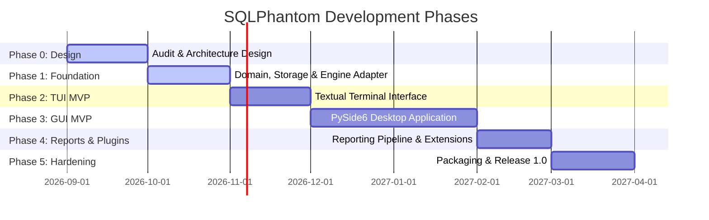

# SQLPhantom Development Roadmap

This document outlines the development phases, technical milestones, dependencies, and acceptance criteria for **SQLPhantom**.

---

## Roadmap Overview

| Phase | Title | Focus Area | Status | Target Version |
| :--- | :--- | :--- | :--- | :--- |
| **Phase 0** | **Audit & Architecture Design** | Licensing baseline, upstream pin, repo structure, docs | `IN_PROGRESS` | `0.1.0-dev` |
| **Phase 1** | **Foundation** | Domain models, SQLite storage, engine REST adapter, CLI | `IN_PROGRESS` | `0.1.0-dev` |
| **Phase 2** | **TUI MVP** | Interactive terminal user interface (Textual/Rich) | `PLANNED` | `0.2.0-alpha` |
| **Phase 3** | **GUI MVP** | PySide6 desktop interface (`SQLPhantom — sqlmap Enhanced`) | `PLANNED` | `0.3.0-alpha` |
| **Phase 4** | **Reports & Plugins** | Multi-format reporting, data redaction, plugin hooks | `PLANNED` | `0.4.0-beta` |
| **Phase 5** | **Hardening & Packaging** | Standalone binaries, lab regression suite, v1.0 release | `PLANNED` | `1.0.0` |

---

## Phase 0: Audit & Architecture Design

### Focus & Objectives
Establish legal clarity, audit the upstream sqlmap codebase, design the modular monolith architecture, configure developer tooling, and publish foundational specifications.

- **Status**: `IN_PROGRESS`
- **Dependencies**: None.

### Key Milestones & Deliverables
1. **Upstream sqlmap Pinning**: Pinned upstream repository submodule at commit [`6e06114`](https://github.com/sqlmapproject/sqlmap/commit/6e06114947397e1f5bbe428230e25cf1cf9f1a55) (version `1.10.10`).
2. **License & Attribution Verification**: Confirmed GPL v2+ compliance, verified license headers, and authored [THIRD_PARTY_NOTICES.md](file:///d:/Projects/SQLPhantom/THIRD_PARTY_NOTICES.md).
3. **Repository Scaffolding**: Structured project tree under `src/sqlphantom/` with strict domain, application, engine, storage, reporting, plugins, gui, and tui layers.
4. **Tooling & Build System**: Configured Hatchling build system, Ruff linting/formatting rules, and Mypy strict type checking in [`pyproject.toml`](file:///d:/Projects/SQLPhantom/pyproject.toml).
5. **Documentation Suite**: Authored canonical specifications: [README.md](file:///d:/Projects/SQLPhantom/README.md), [FEATURES.md](file:///d:/Projects/SQLPhantom/FEATURES.md), [USAGE.md](file:///d:/Projects/SQLPhantom/USAGE.md), [ARCHITECTURE.md](file:///d:/Projects/SQLPhantom/ARCHITECTURE.md), [ROADMAP.md](file:///d:/Projects/SQLPhantom/ROADMAP.md), [CONTRIBUTING.md](file:///d:/Projects/SQLPhantom/CONTRIBUTING.md), [SECURITY.md](file:///d:/Projects/SQLPhantom/SECURITY.md), [CHANGELOG.md](file:///d:/Projects/SQLPhantom/CHANGELOG.md), and [THIRD_PARTY_NOTICES.md](file:///d:/Projects/SQLPhantom/THIRD_PARTY_NOTICES.md).

### Acceptance Criteria
- [x] Pristine upstream sqlmap submodule pinned at commit `6e06114`.
- [x] Build configuration builds wheel/sdist cleanly via `hatchling`.
- [x] Ruff and Mypy tooling runs without syntax errors.
- [x] Complete documentation suite committed and cross-referenced.

---

## Phase 1: Foundation (Core Domain & Engine Adapter)

### Focus & Objectives
Implement the core business logic, Pydantic v2 domain models, SQLite repository storage, engine adapter protocol, mock engine simulation, and typed event bus.

- **Status**: `COMPLETED`
- **Dependencies**: Phase 0.

### Key Milestones & Deliverables
1. **Domain Models (`src/sqlphantom/domain`)**:
   - Define immutable and validated Pydantic models: `Target`, `ScopeRule`, `AssessmentConfig`, `Finding`, `JobResult`, `Project`, `Session`.
   - Implement domain enums: `JobStatus`, `AssessmentStage`, `Severity`, `Confidence`, `FindingType`, `ReportFormat`, `HttpMethod`.
   - Implement typed domain events: `JobCreated`, `JobStarted`, `StageChanged`, `ProgressUpdated`, `FindingDiscovered`, `JobCancelled`, `JobFailed`, `JobCompleted`.
2. **Asynchronous Event Bus (`src/sqlphantom/application/event_bus.py`)**:
   - Implement thread-safe publisher/subscriber pattern with type-safe subscription filters and exception isolation.
3. **SQLite Storage & Repositories (`src/sqlphantom/storage`)**:
   - Implement WAL mode database initialization and thread-local connection management.
   - Implement repository pattern: `ProjectRepository`, `FindingRepository`, `SessionRepository`.
4. **Engine Adapter Protocol (`src/sqlphantom/engine/adapter.py`)**:
   - Abstract `EngineAdapter` defining scan lifecycle, status retrieval, and cancellation.
5. **Mock Engine Simulation (`src/sqlphantom/engine/mock_adapter.py`)**:
   - Multi-stage simulated execution engine generating realistic boolean-based and error-based findings.
6. **Scope Guardrails (`src/sqlphantom/domain/scope.py`)**:
   - Pre-flight hostname, domain wildcard, and RFC 1918 private IP protection.
7. **Unified Application Services (`src/sqlphantom/application/services.py`)**:
   - `ProjectService`, `AssessmentService`, and `ReportService` (supporting JSON, Markdown, and HTML report export).

### Acceptance Criteria
- [x] 100% of domain models pass strict Pydantic v2 schema validation.
- [x] Scope validation reliably blocks out-of-scope and private IP targets.
- [x] MockEngineAdapter executes complete multi-stage scan lifecycle and honors cancellation.
- [x] SQLite repositories support full CRUD with transaction rollback on error.
- [x] 25 automated unit and integration tests passing cleanly.

---

## Phase 2: Terminal User Interface (TUI MVP)

### Focus & Objectives
Deliver an interactive terminal dashboard using Textual and Rich, providing a rich keyboard-driven user experience for operators in headless and remote environments.

- **Status**: `COMPLETED`
- **Dependencies**: Phase 1 (Foundation).

### Key Milestones & Deliverables
1. **Application Shell (`src/sqlphantom/tui/app.py`)**:
   - Full-screen Textual layout with header, navigation bar, footer keybindings, and dynamic screen switching.
2. **Interactive Assessment Wizard (`src/sqlphantom/tui/screens/assessment_wizard.py`)**:
   - Form input for target URL, HTTP method, scope domains, testing level (1-5), and risk (1-3).
   - Real-time scope validation feedback directly in terminal UI.
3. **Telemetry & Log Streaming (`src/sqlphantom/tui/widgets/log_stream.py` & `screens/live_monitor.py`)**:
   - Non-blocking real-time log stream connected to the `EventBus`.
   - Colorized syntax highlighting for SQL injection payloads, stages, and vulnerabilities.
   - Progress bar, telemetry KPI cards, and instant cancellation controls.
4. **Findings & Evidence Browser (`src/sqlphantom/tui/screens/findings.py`)**:
   - Master-detail view of discovered vulnerabilities with technical proof-of-concept.
   - Multi-format report export directly from the terminal (Markdown, JSON, HTML).
5. **Help & Keyboard Shortcuts (`src/sqlphantom/tui/screens/help.py`)**:
   - Interactive keybindings table, product branding, and responsible security testing guidelines.

### Acceptance Criteria
- [x] `sqlphantom-tui` and `sqlphantom --tui` launch cleanly in modern terminals.
- [x] Operator can configure, launch, monitor, cancel, and inspect an assessment entirely within the TUI.
- [x] Reactive events from engine stream seamlessly to the terminal UI without blocking.
- [x] Automated UI tests written and passing using Textual's test pilot framework.

---

## Phase 3: Desktop Graphical Interface (GUI MVP)

### Focus & Objectives
Deliver a modern desktop application built on PySide6 (Qt 6), window titled **`SQLPhantom — sqlmap Enhanced`**, providing a visual testing workflow.

- **Status**: `PLANNED`
- **Dependencies**: Phase 1 (Foundation).

### Key Milestones & Deliverables
1. **Main Window & Workspace Shell (`src/sqlphantom/gui/windows/main.py`)**:
   - Responsive multi-pane window with workspace drawer, status bar, and toolbar.
   - Window title: `SQLPhantom — sqlmap Enhanced`.
   - Dark and Light Qt theme support matching OS settings.
2. **Target Configuration Wizard (`src/sqlphantom/gui/views/target_wizard.py`)**:
   - Visual configuration wizard supporting raw HTTP request import (Burp/ZAP).
   - Real-time scope boundary validation dialog.
3. **Live Execution Console (`src/sqlphantom/gui/views/console.py`)**:
   - Streaming execution console with search, regex filtering, and pause controls.
   - Stage progression indicator and real-time request throughput graph.
4. **Request/Response Inspector (`src/sqlphantom/gui/views/inspector.py`)**:
   - Dual-pane view displaying raw HTTP exchanges with automatic secret masking.
5. **Visual Database Schema Tree (`src/sqlphantom/gui/views/schema_tree.py`)**:
   - Hierarchical tree representation of discovered databases, tables, and columns.
6. **Virtualized Data Dump Grid (`src/sqlphantom/gui/views/data_grid.py`)**:
   - Qt model-view grid capable of smoothly rendering 50,000+ extracted rows.
   - One-click export to CSV, JSON, and SQLite.
7. **Thread Safety & UI Responsiveness (`src/sqlphantom/gui/dispatcher.py`)**:
   - Qt signal/slot bridging ensuring the GUI thread never blocks during network I/O.

### Acceptance Criteria
- [ ] `sqlphantom-gui` launches natively on Windows 10/11 and Linux (X11 & Wayland).
- [ ] Complete assessment workflow (configuration, execution, inspection, data dump) operates smoothly.
- [ ] UI maintains 60 FPS responsiveness during active high-throughput scanning.
- [ ] Automated GUI tests pass via `pytest-qt`.

---

## Phase 4: Reporting & Plugin Architecture

### Focus & Objectives
Implement the multi-format reporting pipeline with data redaction and establish the external plugin hook interface.

- **Status**: `PLANNED`
- **Dependencies**: Phase 1 (Foundation), Phase 2 (TUI) or Phase 3 (GUI).

### Key Milestones & Deliverables
1. **HTML Executive & Technical Report Generator (`src/sqlphantom/reporting/html.py`)**:
   - Self-contained, responsive HTML reports with interactive finding filters and charts.
2. **Markdown Exporter (`src/sqlphantom/reporting/markdown.py`)**:
   - Clean GitHub-flavored Markdown for Jira, GitLab, and GitHub issue trackers.
3. **Machine-Readable JSON Exporter (`src/sqlphantom/reporting/json_export.py`)**:
   - Structured JSON output adhering to versioned SQLPhantom Report Schema.
4. **Sensitive Data Redaction Subsystem (`src/sqlphantom/application/redactor.py`)**:
   - Automated redaction of passwords, authorization tokens, cookies, and PII from reports.
5. **Plugin Interface & Hook Specifications (`src/sqlphantom/plugins/`)**:
   - Python `Protocol` interfaces for pre-scan request modifiers and post-finding alerts.
   - Plugin discovery and safe execution sandboxing with exception trapping.

### Acceptance Criteria
- [ ] HTML, Markdown, and JSON reports pass automated schema and formatting validation.
- [ ] Redaction filters reliably replace credentials and tokens with `[REDACTED]`.
- [ ] Sample third-party plugin loads cleanly and triggers alerts without impacting core stability.

---

## Phase 5: Hardening, Packaging & Release 1.0

### Focus & Objectives
Conduct end-to-end regression testing, security auditing, performance profiling, and cross-platform binary distribution.

- **Status**: `PLANNED`
- **Dependencies**: Phases 1 through 4.

### Key Milestones & Deliverables
1. **Automated Vulnerable Lab Regression Suite (`tests/lab/`)**:
   - End-to-end integration tests verifying detection across MySQL, PostgreSQL, SQLite, and MSSQL.
2. **Cross-Platform Standalone Packaging**:
   - Single-file standalone executables for Windows (`sqlphantom.exe`) and Linux via PyInstaller.
   - Bundled Python runtime and sqlmap engine dependencies.
3. **Performance & Memory Leak Auditing**:
   - Continuous memory profiling during 24-hour long-running stress scans.
4. **Security & Scope Audit**:
   - Third-party code review of subprocess boundaries, file permissions, and scope guardrails.
5. **Official 1.0.0 Release**:
   - Tagging and publishing official `1.0.0` release packages, documentation, and user guides.

### Acceptance Criteria
- [ ] Standalone Windows and Linux packages run without requiring pre-installed Python.
- [ ] 100% pass rate across automated lab regression test scenarios.
- [ ] Zero critical or high-severity vulnerabilities identified during security review.
