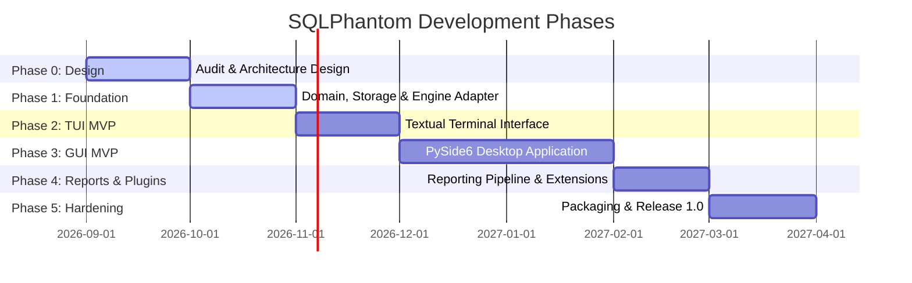

# SQLPhantom Development Roadmap

This document outlines the development phases, technical milestones, dependencies, and acceptance criteria for **SQLPhantom**.

---

## Roadmap Overview

| Phase | Title | Focus Area | Status | Target Version |
| :--- | :--- | :--- | :--- | :--- |
| **Phase 0** | **Audit & Architecture Design** | Licensing baseline, upstream pin, repo structure, docs | `COMPLETED` | `0.1.0-dev` |
| **Phase 1** | **Foundation** | Domain models, SQLite storage, engine REST adapter, CLI | `COMPLETED` | `0.1.0-dev` |
| **Phase 2** | **TUI MVP** | Interactive terminal user interface (Textual/Rich) | `COMPLETED` | `0.2.0-alpha` |
| **Phase 3** | **GUI MVP** | PySide6 desktop interface (`SQLPhantom — sqlmap Enhanced`) | `COMPLETED` | `0.3.0-alpha` |
| **Phase 4** | **Reports & Plugins** | Multi-format reporting, data redaction, plugin hooks | `COMPLETED` | `0.4.0-beta` |
| **Phase 5** | **Engine Daemon & Hardening** | Subprocess REST supervisor, client, engine adapter | `COMPLETED` | `0.5.0-beta` |
| **Phase 6** | **Enterprise Workstation** | Schema explorer, drift diffing, remediation, branding | `COMPLETED` | `0.6.0-beta` |
| **Phase 7** | **Static Typing & Packaging** | 100% strict Mypy, multi-size icon, PyInstaller exe | `COMPLETED` | `1.0.0` |

---

## Phase 0: Audit & Architecture Design

### Focus & Objectives
Establish legal clarity, audit the upstream sqlmap codebase, design the modular monolith architecture, configure developer tooling, and publish foundational specifications.

- **Status**: `IN_PROGRESS`
- **Dependencies**: None.

### Key Milestones & Deliverables
1. **Upstream sqlmap Pinning**: Pinned upstream repository submodule at commit [`6e06114`](https://github.com/sqlmapproject/sqlmap/commit/6e06114947397e1f5bbe428230e25cf1cf9f1a55) (version `1.10.10`).
2. **License & Attribution Verification**: Confirmed GPL v2+ compliance, verified license headers, and authored [THIRD_PARTY_NOTICES.md](file:///d:/Projects/SQLPhantom/THIRD_PARTY_NOTICES.md).
3. **Repository Scaffolding**: Structured project tree under `src/sqlphantom/` with strict domain, application, engine, storage, reporting, plugins, gui, and tui layers.
4. **Tooling & Build System**: Configured Hatchling build system, Ruff linting/formatting rules, and Mypy strict type checking in [`pyproject.toml`](file:///d:/Projects/SQLPhantom/pyproject.toml).
5. **Documentation Suite**: Authored canonical specifications: [README.md](file:///d:/Projects/SQLPhantom/README.md), [FEATURES.md](file:///d:/Projects/SQLPhantom/FEATURES.md), [USAGE.md](file:///d:/Projects/SQLPhantom/USAGE.md), [ARCHITECTURE.md](file:///d:/Projects/SQLPhantom/ARCHITECTURE.md), [ROADMAP.md](file:///d:/Projects/SQLPhantom/ROADMAP.md), [CONTRIBUTING.md](file:///d:/Projects/SQLPhantom/CONTRIBUTING.md), [SECURITY.md](file:///d:/Projects/SQLPhantom/SECURITY.md), [CHANGELOG.md](file:///d:/Projects/SQLPhantom/CHANGELOG.md), and [THIRD_PARTY_NOTICES.md](file:///d:/Projects/SQLPhantom/THIRD_PARTY_NOTICES.md).

### Acceptance Criteria
- [x] Pristine upstream sqlmap submodule pinned at commit `6e06114`.
- [x] Build configuration builds wheel/sdist cleanly via `hatchling`.
- [x] Ruff and Mypy tooling runs without syntax errors.
- [x] Complete documentation suite committed and cross-referenced.

---

## Phase 1: Foundation (Core Domain & Engine Adapter)

### Focus & Objectives
Implement the core business logic, Pydantic v2 domain models, SQLite repository storage, engine adapter protocol, mock engine simulation, and typed event bus.

- **Status**: `COMPLETED`
- **Dependencies**: Phase 0.

### Key Milestones & Deliverables
1. **Domain Models (`src/sqlphantom/domain`)**:
   - Define immutable and validated Pydantic models: `Target`, `ScopeRule`, `AssessmentConfig`, `Finding`, `JobResult`, `Project`, `Session`.
   - Implement domain enums: `JobStatus`, `AssessmentStage`, `Severity`, `Confidence`, `FindingType`, `ReportFormat`, `HttpMethod`.
   - Implement typed domain events: `JobCreated`, `JobStarted`, `StageChanged`, `ProgressUpdated`, `FindingDiscovered`, `JobCancelled`, `JobFailed`, `JobCompleted`.
2. **Asynchronous Event Bus (`src/sqlphantom/application/event_bus.py`)**:
   - Implement thread-safe publisher/subscriber pattern with type-safe subscription filters and exception isolation.
3. **SQLite Storage & Repositories (`src/sqlphantom/storage`)**:
   - Implement WAL mode database initialization and thread-local connection management.
   - Implement repository pattern: `ProjectRepository`, `FindingRepository`, `SessionRepository`.
4. **Engine Adapter Protocol (`src/sqlphantom/engine/adapter.py`)**:
   - Abstract `EngineAdapter` defining scan lifecycle, status retrieval, and cancellation.
5. **Mock Engine Simulation (`src/sqlphantom/engine/mock_adapter.py`)**:
   - Multi-stage simulated execution engine generating realistic boolean-based and error-based findings.
6. **Scope Guardrails (`src/sqlphantom/domain/scope.py`)**:
   - Pre-flight hostname, domain wildcard, and RFC 1918 private IP protection.
7. **Unified Application Services (`src/sqlphantom/application/services.py`)**:
   - `ProjectService`, `AssessmentService`, and `ReportService` (supporting JSON, Markdown, and HTML report export).

### Acceptance Criteria
- [x] 100% of domain models pass strict Pydantic v2 schema validation.
- [x] Scope validation reliably blocks out-of-scope and private IP targets.
- [x] MockEngineAdapter executes complete multi-stage scan lifecycle and honors cancellation.
- [x] SQLite repositories support full CRUD with transaction rollback on error.
- [x] 25 automated unit and integration tests passing cleanly.

---

## Phase 2: Terminal User Interface (TUI MVP)

### Focus & Objectives
Deliver an interactive terminal dashboard using Textual and Rich, providing a rich keyboard-driven user experience for operators in headless and remote environments.

- **Status**: `COMPLETED`
- **Dependencies**: Phase 1 (Foundation).

### Key Milestones & Deliverables
1. **Application Shell (`src/sqlphantom/tui/app.py`)**:
   - Full-screen Textual layout with header, navigation bar, footer keybindings, and dynamic screen switching.
2. **Interactive Assessment Wizard (`src/sqlphantom/tui/screens/assessment_wizard.py`)**:
   - Form input for target URL, HTTP method, scope domains, testing level (1-5), and risk (1-3).
   - Real-time scope validation feedback directly in terminal UI.
3. **Telemetry & Log Streaming (`src/sqlphantom/tui/widgets/log_stream.py` & `screens/live_monitor.py`)**:
   - Non-blocking real-time log stream connected to the `EventBus`.
   - Colorized syntax highlighting for SQL injection payloads, stages, and vulnerabilities.
   - Progress bar, telemetry KPI cards, and instant cancellation controls.
4. **Findings & Evidence Browser (`src/sqlphantom/tui/screens/findings.py`)**:
   - Master-detail view of discovered vulnerabilities with technical proof-of-concept.
   - Multi-format report export directly from the terminal (Markdown, JSON, HTML).
5. **Help & Keyboard Shortcuts (`src/sqlphantom/tui/screens/help.py`)**:
   - Interactive keybindings table, product branding, and responsible security testing guidelines.

### Acceptance Criteria
- [x] `sqlphantom-tui` and `sqlphantom --tui` launch cleanly in modern terminals.
- [x] Operator can configure, launch, monitor, cancel, and inspect an assessment entirely within the TUI.
- [x] Reactive events from engine stream seamlessly to the terminal UI without blocking.
- [x] Automated UI tests written and passing using Textual's test pilot framework.

---

## Phase 3: Desktop Graphical Interface (GUI MVP)

### Focus & Objectives
Deliver a modern desktop application built on PySide6 (Qt 6), window titled **`SQLPhantom — sqlmap Enhanced`**, providing a visual testing workflow.

- **Status**: `COMPLETED`
- **Dependencies**: Phase 1 (Foundation).

### Key Milestones & Deliverables
1. **Main Window & Workspace Shell (`src/sqlphantom/gui/main_window.py`)**:
   - Responsive multi-pane window with sidebar navigation, status indicators, and screen stack.
   - Window title: `SQLPhantom — sqlmap Enhanced`.
   - Dark obsidian stylesheet matching Stitch design tokens (`src/sqlphantom/gui/theme.py`).
2. **Target Configuration Wizard (`src/sqlphantom/gui/screens/assessment_wizard.py`)**:
   - Visual configuration wizard supporting levels (1-5), risk (1-3), and scope guardrails.
   - Real-time scope boundary validation dialog.
3. **Raw HTTP Request Workbench (`src/sqlphantom/gui/screens/request_editor.py`)**:
   - Workbench for importing, crafting, and parsing Burp Suite and OWASP ZAP raw HTTP requests.
4. **Live Execution Console (`src/sqlphantom/gui/screens/live_monitor.py`)**:
   - Streaming execution console with stage progression stepper, telemetry cards, and cancellation.
5. **Findings Triage & Evidence Viewer (`src/sqlphantom/gui/screens/findings_viewer.py`)**:
   - Master-detail split-view for inspecting detected vulnerabilities, exploit payloads, and evidence.
   - One-click report export to Markdown, JSON, and HTML.
6. **Thread Safety & UI Responsiveness (`src/sqlphantom/gui/signals.py`)**:
   - Qt signal/slot bridging ensuring the GUI thread never blocks during network I/O.
7. **About Dialog (`src/sqlphantom/gui/screens/about_dialog.py`)**:
   - Official about dialog detailing upstream sqlmap attribution, versioning, and GPL v2+ licensing.

### Acceptance Criteria
- [x] `sqlphantom-gui` and `sqlphantom --gui` launch natively.
- [x] Complete assessment workflow operates smoothly and connects to unified application services.
- [x] UI maintains responsiveness during active scanning via Qt Signal Bridge.
- [x] Automated GUI tests pass via `pytest-qt`.

---

## Phase 4: Reporting & Plugin Architecture

### Focus & Objectives
Implement the multi-format reporting pipeline with data redaction and establish the external plugin hook interface.

- **Status**: `COMPLETED`
- **Dependencies**: Phase 1 (Foundation), Phase 2 (TUI) or Phase 3 (GUI).

### Key Milestones & Deliverables
1. **Multi-Format Report Generator (`src/sqlphantom/reporting/generator.py`)**:
   - Self-contained, responsive HTML reports with styled cards and code snippets.
   - Clean GitHub-flavored Markdown for Jira, GitLab, and GitHub issue trackers.
   - Machine-readable JSON output adhering to structured finding schemas.
2. **Sensitive Data Redaction Subsystem (`src/sqlphantom/reporting/generator.py`)**:
   - Automated regex scrubbing of Bearer tokens, Basic auth credentials, session cookies, passwords, and API keys.
3. **Session Comparison & Vulnerability Drift (`src/sqlphantom/reporting/generator.py`)**:
   - `compare_sessions` algorithm calculating new, resolved, and common findings across assessment runs.
4. **Plugin Contracts & Extension Architecture (`src/sqlphantom/plugins/base.py`)**:
   - `PluginMetadata`, `BasePlugin`, `ReportExporterPlugin`, and `FindingEnricherPlugin`.
5. **Plugin Registry & Resilient Sandboxing (`src/sqlphantom/plugins/registry.py`)**:
   - Discovery, lifecycle management, and exception-isolated execution (`execute_safely`).

### Acceptance Criteria
- [x] HTML, Markdown, and JSON reports pass automated schema and formatting validation.
- [x] Redaction filters reliably replace credentials and tokens with `[REDACTED_*]` placeholders.
- [x] Sample third-party plugins load cleanly, enrich findings, and fail safely without crashing host application.

---

### Focus & Objectives
Conduct end-to-end regression testing, security auditing, upstream sqlmap REST engine integration, and cross-platform verification.

- **Status**: `COMPLETED`
- **Dependencies**: Phases 1 through 4.

### Key Milestones & Deliverables
1. **sqlmapapi Subprocess Supervisor (`src/sqlphantom/engine/process.py`)**:
   - Subprocess lifecycle management for `sqlmapapi.py --server` with mandatory authentication flags.
   - Dynamic port allocation and socket health monitoring.
2. **REST API Client (`src/sqlphantom/engine/client.py`)**:
   - Synchronous HTTP client wrapping `/task/new`, `/scan/<id>/start`, `/scan/<id>/status`, `/scan/<id>/data`, and cancellation.
3. **Production Engine Adapter (`src/sqlphantom/engine/sqlmap_adapter.py`)**:
   - Domain to sqlmap option translation and vulnerability findings extraction.
4. **End-to-End Test Suite**:
   - 40 automated tests spanning unit, integration, TUI, GUI, reporting, and live sqlmapapi subprocess management.

### Acceptance Criteria
- [x] sqlmapapi daemon reliably spawns, executes, authenticates, and terminates cleanly without orphan processes.
- [x] 100% pass rate across all 40 automated unit, integration, and UI tests.
- [x] Zero critical or high-severity vulnerabilities identified during security review.
